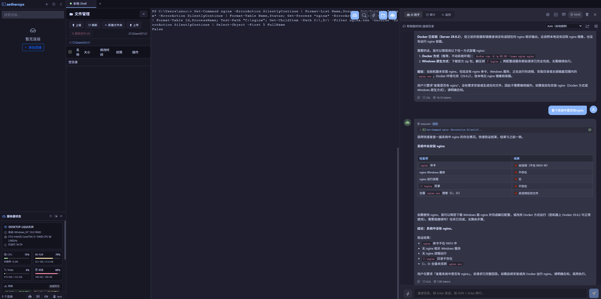
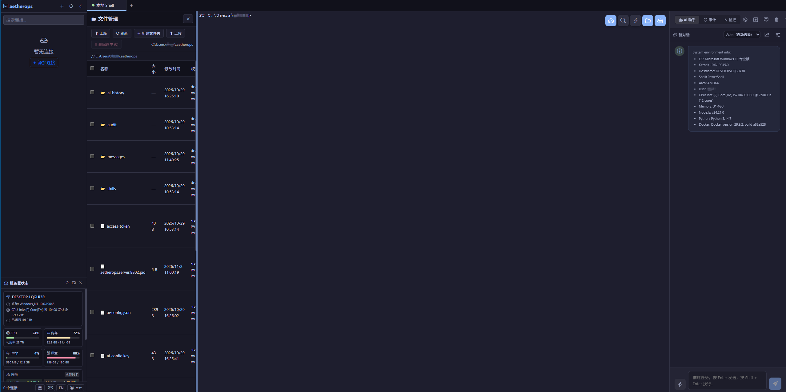

# AetherOps

**[Documentation index](./docs/)** · **[中文 README](./README.zh.md)** · **[Contributing](./CONTRIBUTING.md)** · **[Security policy](./SECURITY.md)**

An AI-powered SSH operations terminal. It combines a full-featured terminal emulator with an
autonomous agent that understands the machine it is standing on — it detects the target operating
system, runs commands, reads back the output, and iterates until the task is done. It ships as a
**Web app**, an **Electron desktop client**, and a **VSCode extension** that all run the exact same
backend, plus **multi-account access control** so a team can share one deployment safely.

> ⚠️ AetherOps gives an AI agent a real shell on your servers. Read
> [Safety rails](#safety-rails) and [SECURITY.md](./SECURITY.md) before exposing it beyond localhost.

## Screenshot

**Desktop / Web**



**VSCode extension**



## Contents

- [What it does](#what-it-does)
- [Requirements](#requirements)
- [Quick start](#quick-start)
- [Installation options](#installation-options)
- [Configuration](#configuration)
- [Architecture](#architecture)
- [Development](#development)
- [Safety rails](#safety-rails)
- [Network egress & privacy](#network-egress--privacy)
- [Cross-platform support](#cross-platform-support)
- [Known limitations](#known-limitations)
- [Documentation](#documentation)
- [Contributing](#contributing)
- [License & attribution](#license--attribution)

## What it does

### AI agent

- **Autonomous loop.** The agent executes commands in a real terminal through tool calling
  (OpenAI function-calling protocol), observes the output, decides the next step, and keeps going
  until the task completes — it does not just hand you a list of commands.
- **Pinned engine.** The ReAct loop, built-in tools (`execute_command` / `read_terminal`), the
  dangerous-command blacklist and the delete protection come from
  [`@cicctencent/agent-core`](https://www.npmjs.com/package/@cicctencent/agent-core), held to an
  exact version so behavior cannot silently change under you
  (see [Version pinning](#version-pinning)).
- **System awareness.** On connect, the backend collects OS/kernel, CPU, memory, swap, disk,
  network, uptime, logged-in users, service managers and available runtimes (Node/Python/Docker),
  then injects it into the prompt. The agent knows whether it is on Windows, Linux, macOS or
  HarmonyOS before it types its first command.
- **Cross-platform command selection.** `systemctl` on Linux, `launchctl` on macOS,
  `Get-Service` on Windows, `param`/toybox on OpenHarmony — chosen from the detected family, not
  guessed from the connection type.
- **Script generation.** For multi-step work the agent writes and runs a Bash / PowerShell /
  Python script instead of dribbling one command at a time.
- **Language adaptation.** Replies follow the language of your message, falling back to the UI
  locale when the message is ambiguous.
- **Terminal-bound, not invented.** Tools are bound to the terminal session you picked, so a
  command really runs there. If no session is available the agent says so instead of making up
  output.

### Server status & OS self-detection

- A live panel per session: CPU, memory, swap, disk, network throughput, uptime, load, hostname,
  plus a CPU history curve.
- **Four families recognized out of the box** — Windows, macOS, Linux and HarmonyOS (OpenHarmony
  devices reached over SSH), with a generic Unix-like fallback for FreeBSD/OpenBSD/Solaris and
  friends.
- Detection is a single portable probe (`uname -s`, `ver`, os-release, HarmonyOS markers) followed
  by a family-specific collection script. Nothing is hard-coded per host.
- Windows works whether `sshd` drops you into **cmd.exe or PowerShell**: the script is
  single-line, avoids `$`/`%`/quotes that get mangled in transit, and forces UTF-8 output so
  localized system names do not arrive as mojibake.
- **Honest gaps.** Each metric carries a `supported` flag; anything the platform cannot report
  (e.g. CPU busy% on some BSDs, swap on HarmonyOS) shows as *unavailable* instead of a flattering
  `0`, and the history chart stops drawing rather than plotting a fake flat line.

### Multi-account access control

- Accounts with `admin` / `user` roles and **10 independent permission bits**: terminal, batch,
  AI, connections, AI configuration, file manager, monitor, audit, skills, snippets.
- Every business table is scoped by `owner_id`: connections, sessions, AI profiles, chats, audit
  events, snippets and skills are private to their account.
- Self-service registration lands as `pending` with zero permissions until an admin grants access.
- Admin console: create/disable accounts, reset passwords, revoke tokens, and — the single
  deliberate exception to account isolation — inspect a member's audit trail, file transfers,
  connection inventory (secrets stripped) and live sessions, and force-disconnect a user.
- Sessions are OAuth2-style bearer tokens kept in Redis with a sliding TTL, hashed at rest,
  single active session per account (a new login replaces the old one).
- Passwords use `scrypt`; SSH passwords / private keys / passphrases and AI API keys are stored
  in MySQL as `enc:v1:` AES-256-GCM ciphertext, with the keys in the local data directory —
  a database dump alone does not leak credentials.

### AI model management, auto routing & cost governance

- **Multiple provider profiles per account** (OpenAI, Anthropic, Tencent, Azure OpenAI, or any
  OpenAI-compatible endpoint via *custom* base URL) — not one global config.
- **Auto routing**: pick `auto` as the model and each turn is scored locally (instruction length,
  code blocks, whether you want action or explanation, troubleshooting wording, terminal context
  size, tool calls already made) and mapped to a cost tier from 1 (cheapest) to 5 (strongest).
  Zero extra LLM calls, and the reason is surfaced in the UI so you can see why that model ran.
- **Tier detection from a pricing catalog**, so four profiles left at the default tier do not all
  collapse onto the same model; relative ranking inside your own profiles survives vendor
  price cuts.
- **Usage accounting**: every completion records tokens and a cost snapshot fixed at the price of
  the moment (later price changes never rewrite history); per-chat and per-day totals are
  queryable.
- **Budgets**: per-account token / cost ceilings (per chat, per day). 0 means unlimited; exceeding
  a limit stops the call with an explicit error rather than a silent truncation.

### Terminal

- SSH terminal on xterm.js + ssh2, 256 colors, with local shells through node-pty
  (bash/zsh on Linux/macOS, PowerShell/cmd on Windows).
- Tabbed multi-session management; sessions and transcripts are persisted server-side and survive
  restarts; one-click reconnect for dropped SSH links; per-user session ownership checks.
- **File transfer two ways**: ZMODEM (`rz`/`sz`) inside the terminal, and an SFTP **file manager**
  (browse, mkdir, rename, delete, download, upload) sharing the live connection. Every transfer is
  audited with direction, path, byte count and duration.
- **Snippets panel** for reusable commands, stored per account.
- Adaptive layout: the terminal re-fits its column count when the AI panel opens or closes;
  terminal search addon; VSCode theme adaptation when embedded in the editor.

### Jump host & SSH agent forwarding

- Per-connection **startup script** executed after login — the usual `ssh target.internal` hop.
- **Agent forwarding** so the second hop authenticates with your local key: no private key on the
  bastion. Auto-detects `SSH_AUTH_SOCK` on Unix and the OpenSSH agent pipe on Windows.
- For scripted hops, environment collection is family-aware and runs against the **target**
  machine rather than reporting the bastion, with prompt-line stripping so the transcript stays
  clean; results are cached per session.
- Details: [docs/jump-host.md](./docs/jump-host.md).

### Skills

- Built-in operational playbooks shipped in `data/skills/`: server health check, log analysis,
  Docker management.
- Markdown + YAML front matter, injected into the system prompt for that run. Selection is always
  explicit: pick it in the skills panel, or type `/skill-id` (exact id match, optional trailing task
  text). There is no tag-based auto-matching and the model does not choose a skill by itself.
- User-scoped skills live in the `skills` table (schema and service layer in place; the write API
  is not exposed yet — see [docs/skills-guide.md](./docs/skills-guide.md)).

### Command audit & replay

- Every command the agent runs is recorded with timestamp, session, command, output, duration and
  status (`success` / `error` / `blocked` / `rewritten`), plus file transfers as a separate tool
  category.
- Timeline view with keyword/status filters, statistics overview, JSON/CSV export, real-time panel
  updates over the same WebSocket, and automatic retention cleanup.

### Real-time log monitoring + AI anomaly detection

- `tail -f` any log file on a remote host or locally; patterns for ERROR / FATAL / CRITICAL /
  Exception / Traceback raise categorized alerts; color-coded streaming; one click sends the recent
  window to the agent for analysis.

### Batch operations

- Fan one command out to many live SSH sessions in parallel, with per-host status, output and
  duration, expandable details, copy-to-clipboard and task history.
- Gated by its **own permission bit** (blast radius is bigger than a single terminal, so admins
  can withhold exactly this).

### Hosts & general

- **Web**: `node server.js` and open a browser.
- **Electron desktop** for Windows / macOS / Linux, with an update check against GitHub Releases
  (it notifies, it never auto-downloads).
- **VSCode extension** embedding the same backend and SPA, launching its own localhost server and
  adopting the editor theme. It starts the ordinary production backend, so it needs the same MySQL +
  Redis configuration in `~/.aetherops/config.json` and an account to sign in with — see
  [`packages/vscode`](./packages/vscode/README.md).
- **i18n**: Chinese / English UI, switchable at runtime.
- **CI/CD**: GitHub Actions builds installers for all platforms and the `.vsix`.

## Requirements

| Component | Requirement | Notes |
|-----------|-------------|-------|
| Node.js | **>= 22.17** | Required by the agent engine's `engines`; CI and the Docker image use Node 22 |
| Package manager | **pnpm 10** | What the lockfile, CI, the Docker image and `scripts/check-engine-pin.mjs` are standardized on. Native-module build permissions are declared in two places with deliberately overlapping roles — `pnpm-workspace.yaml` (`onlyBuiltDependencies` for pnpm 10/11, `allowBuilds` for pnpm 12+) and `package.json#pnpm` (a shorter list plus the patch, read by older pnpm that ignores the workspace keys). A lock rewritten by pnpm 11/12 is rejected by CI's pnpm 10 under `--frozen-lockfile` |
| MySQL | 8.x | Hard dependency — the server refuses to start without it |
| Redis | any recent RESP server | Hard dependency — login tokens live here |
| Build tools | python3, make, g++ (Linux) / Xcode CLT (macOS) / VS Build Tools (Windows) | Native modules: node-pty, ssh2, cpu-features |

MySQL and Redis are **not optional**: startup validates the configuration, probes both services,
applies schema migrations and only then binds the port. If either is unreachable the process exits
with a readable message instead of opening a port that answers every query with an error.

## Quick start

```bash
# 1. Get the code
git clone https://github.com/SubDong/AetherOps.git
cd AetherOps

# 2. Install (pnpm 10, frozen lockfile)
npm i -g pnpm@10        # plain `corepack enable` is not enough: this repo has no
                        # `packageManager` field, so corepack would pick a newer major
pnpm install --frozen-lockfile

# 3. Build frontend + server
pnpm build

# 4. Point it at MySQL and Redis.
#    The first run drops a template at ~/.aetherops/config.json (mode 0600) —
#    edit database + redis, or override with environment variables:
export AETHEROPS_DB_HOST=127.0.0.1
export AETHEROPS_DB_USER=aetherops
export AETHEROPS_DB_PASSWORD='...'
export AETHEROPS_DB_NAME=aetherops
export AETHEROPS_REDIS_HOST=127.0.0.1
export AETHEROPS_REDIS_PASSWORD='...'

# 5. Start (tables are created automatically on first boot)
node server.js
```

Then open the URL printed in the log (default <http://127.0.0.1:9802>) and sign in with the
bootstrap administrator:

- When the `users` table is empty the server creates `admin` with a **random 16-character
  password printed once** in the startup log — look for `[Auth] 已创建初始管理员  admin / ...`
  (also in `~/.aetherops/server.log`). Change it right after logging in.
- Then create a connection, and configure at least one AI provider profile in the AI settings
  (gear icon). Nothing is pre-seeded and no demo credentials exist.

Full walkthrough with team setup: [docs/getting-started.md](./docs/getting-started.md).

## Installation options

| Method | Command / source | Good for |
|--------|------------------|----------|
| Source build | `pnpm install && pnpm build && node server.js` | Everyone; currently the only way to get the app |
| Docker | `docker build -t aetherops .` + compose with MySQL/Redis | Servers, shared team deployment |
| Electron desktop | `pnpm electron:build:win \| :mac \| :linux` | Single operators who want a native window |
| VSCode extension | `pnpm vscode:package` → `.vsix`, then *Install from VSIX* | Keeping terminals inside the editor |
| GitHub Releases | Created by CI when a version tag is pushed (**none published yet**) | Installers without a local toolchain |

```bash
# Desktop / extension builds
pnpm electron:dev          # dev mode
pnpm electron:build        # current platform
pnpm build:vscode          # front-end + backend + extension host
pnpm vscode:package        # package a .vsix

# Docker
docker build -t aetherops .
docker run -d -p 9802:9802 -v ~/.aetherops:/root/.aetherops aetherops
```

See [docs/deployment.md](./docs/deployment.md) for a Docker Compose file that brings up MySQL and
Redis alongside the app, reverse-proxy settings (WebSocket upgrade is mandatory), and the release
flow.

### CLI

```bash
aetherops start [-p 9802]   # detached background server, logs to ~/.aetherops/server.log
aetherops stop | restart | -v
```

Shipped via `bin/aetherops.js` (the `bin` field in `package.json`). It is **not** pm2 — it detaches a
`node server.js` child and tracks it through a per-port PID file
(`~/.aetherops/aetherops.server.<port>.pid`), falling back to a port-ownership lookup on stop.
Two behaviors to know: it opens a browser at the local URL, and if the requested port is taken it
**walks forward to the next free port** rather than failing — convenient for a laptop, wrong for a
server behind a reverse proxy that expects a fixed port. For production, prefer systemd or your own
supervisor ([docs/deployment.md](./docs/deployment.md#running-as-a-service)). It needs `dist/` to
exist, so build first.

## Configuration

One config file, two ways to feed it. Priority: built-in defaults < config file < environment
variables.

| Item | Value |
|------|-------|
| Default path | `~/.aetherops/config.json` (auto-created, mode 0600) |
| Override path | `AETHEROPS_DATA_DIR` (data dir) / `AETHEROPS_CONFIG` (explicit file) |
| Sections | `server`, `database`, `redis`, `auth`, `debug` |
| Port / bind | `PORT`, `HOST` (defaults: 9802 on 127.0.0.1) |
| Database | `AETHEROPS_DB_HOST` / `_PORT` / `_USER` / `_PASSWORD` / `_NAME` / `_POOL_SIZE` / `_SSL` / `_TZ` / `_SSL_CA` / `_SSL_INSECURE` |
| Redis | `AETHEROPS_REDIS_URL` or `_HOST` / `_PORT` / `_USER` / `_PASSWORD` / `_DB` / `_PREFIX` / `_CONNECT_TIMEOUT_MS` |
| Misc | `AETHEROPS_MAX_UPLOAD_MB` (default 100), `AETHEROPS_SSH_DEBUG`, `AETHEROPS_LAUNCH_TOKEN` |

A malformed file aborts startup rather than quietly falling back to defaults, and a completed
`database` section prints a `user@host:port/db` summary (no password) so you can see which config
was actually read. Full reference, including TLS choices and the storage layout:
[docs/configuration.md](./docs/configuration.md).

## Architecture

```
.
├── bin/                # CLI entry (aetherops start/stop/restart)
├── data/skills/        # Built-in agent skills (Markdown)
├── docs/               # Documentation (English)
├── electron/           # Desktop main/preload + release update check
├── packages/vscode/    # VSCode extension host (same backend runtime)
├── patches/            # Dependency patches (zmodem.js)
├── scripts/            # Build, pin checks, migration & smoke helpers
├── server/             # Node backend (TypeScript)
│   ├── db/             #   pool, redis, migrations (0001..0005), repositories
│   ├── model/          #   connection / user entities
│   ├── routes/         #   account (login, register, admin user management)
│   ├── service/        #   ssh, ai (+auto-router, pricing, cost), system-status,
│   │                   #   connection, monitor, batch, audit, skill, snippet, auth
│   └── utils/          #   os-detect, security, shell, ansi, config, data-dir
├── src/                # Vue 3 front-end
│   ├── components/     #   ai-chat, server-status, audit/batch/monitor panels,
│   │                   #   file manager, snippet panel, connection editor…
│   ├── views/          #   login / terminal workspace / admin users
│   ├── service/        #   API clients
│   └── locales/        #   zh-CN / en-US
├── server.js           # Production entry: config → migrate → probe → listen
└── vite.config.ts      # Dev server that mounts the same backend (single command)
```

Request flow: browser/WebView → REST `/api/*` plus a WebSocket at `/ws/terminal`; every request
carries a bearer token, is checked against the permission table and the session owner, and reaches
a repository that always takes `owner_id`. Terminal I/O, AI streaming and audit events share the
WebSocket so panels update live.

Storage: **MySQL** holds connections, sessions, AI profiles/chats/messages/usage/budgets, audit
events, skills and snippets (schema migrations run automatically; `node scripts/migrate.mjs --status`
shows what is pending, `--dump <ver>` emits plain SQL for DBA review). **Redis** holds login tokens.
The **data directory** holds the config template, the two AES key files (`connections.key`,
`ai-config.key`), `server.log`, the PID file and the `.trash/` recovery bin.

## Development

```bash
pnpm dev              # Vite on http://127.0.0.1:9801 with the backend mounted in-process
pnpm build            # = build-only: pin check → vite build → tsc server
pnpm build-server     # backend only
pnpm type-check       # vue-tsc
pnpm lint             # eslint (+ --fix)
pnpm check-pin        # verify pinned dependencies match the lockfile
node scripts/migrate.mjs --status   # database schema state
pnpm smoke            # terminal pipeline smoke test (does not send a token yet — see
                      # CONTRIBUTING "Test scripts"; it needs an admin token to pass)
BASE=http://127.0.0.1:9802 ADMIN_USER=admin ADMIN_PASS=... \
  node scripts/verify-auth.mjs   # end-to-end auth/permission/isolation checks
```

`pnpm dev` still needs a reachable MySQL and Redis (migrations run before the port binds). Run
`pnpm install` with pnpm 10 — `pnpm-workspace.yaml` carries the native-module build allow-list
(`onlyBuiltDependencies` / `allowBuilds`) and the `zmodem.js` patch that makes `rz`/`sz` reliable;
skipping it produces a build that installs but cannot transfer files.

### Version pinning

Two dependencies are held to exact versions and verified before every build:
`@cicctencent/agent-core` (the agent engine — a black box whose ReAct loop, built-in tools and
command blacklist live inside it) and `vite` (the bundler that determines front-end output). A clean
install that quietly resolves a newer engine is the worst kind of regression, so `pnpm build`,
Electron packaging, CI and Docker all fail early when declaration and installed copy disagree.
Upgrade deliberately:

```bash
pnpm run upgrade-pin -- @cicctencent/agent-core@1.0.81   # edits the declaration, refreshes the lock, re-verifies
```

Commit `package.json` and `pnpm-lock.yaml` together.

## Safety rails

The agent has real shell access, so the command layer intercepts before execution:

- **Delete protection.** `rm` (Linux/macOS/HarmonyOS) is rewritten to `mv` into
  `~/.aetherops/.trash/`; Windows `Remove-Item` / `del` / `rd` become `Move-Item` into
  `%USERPROFILE%\.aetherops\.trash\`. Entries are timestamped (`_del_<epoch>_<name>`) so nothing
  collides, and recovery is a plain file move back.
- **Hard blocks.** Irreversible operations are refused: `rm -rf /`, `mkfs.*`, `dd of=/dev/sd*`,
  fork bombs; on Windows `format C:`, `Clear-Disk`, `Remove-Item C:\`, `rd /s C:\`.
- **Platform-aware rules.** Which rule set applies comes from the detected OS family of the *target*
  session, not from where the server happens to run.
- **Audit everything.** Blocked and rewritten commands are recorded too — the trail shows what the
  agent tried, not only what succeeded.
- **Least privilege.** Permission bits, admin approval of new accounts, force disconnect, and
  credential material never leaving the owner's view.
- Still: run this behind authentication and on a network you control. It is a remote shell with an
  LLM on top, and prompt content can influence what it types.

## Network egress & privacy

Outbound requests are limited to three things, all of which you control:

| Destination | When | Required? |
|-------------|------|-----------|
| Your AI provider endpoint | Every agent/chat turn | Yes, if you use the AI features |
| `https://openrouter.ai/api/v1/models` | Refreshing the model price catalog (24 h cache, 5 min on failure) | **Optional** — unreachable catalog degrades to name-based tier rules and reports costs as *unknown* rather than guessing |
| `https://api.github.com/repos/SubDong/AetherOps/releases/latest` | Electron startup update check (notification only, and forks should edit `electron/updater.js`) | Optional |

Nothing else phones home. Terminal output, transcripts, audit logs and credentials stay in your
MySQL / Redis / data directory; there is no analytics, no crash reporting, and no cloud sync.
Credentials in the database are AES-256-GCM ciphertext whose keys live only in the data directory.

## Cross-platform support

| Target | Detected family | Shell | Agent scripting | Status metrics |
|--------|-----------------|-------|-----------------|----------------|
| Linux | `Linux` | bash/zsh | Bash + Python + Node.js | /proc based |
| macOS | `Darwin` | zsh/bash | Bash + Python + Node.js | sysctl / vm_stat / top |
| Windows | `Windows NT` | cmd.exe **and** PowerShell (either default shell works) | PowerShell + Python + Node.js | WMI / PerfFormattedData |
| HarmonyOS / OpenHarmony | `Linux` + HongMeng markers | msh / toybox | Bash-compatible, no awk / no `$()` | /proc based |
| FreeBSD / OpenBSD / NetBSD / Solaris | Unix-like | sh | Best effort | CPU busy% may be unavailable |

Anything the platform cannot report is displayed as *unavailable* — the UI never substitutes a zero
to look complete.

## Known limitations

Honest status, so nobody files the same issue twice:

- **HarmonyOS is fixture-tested, not fleet-tested.** Detection and parsing are verified against
  captured OpenHarmony output and generic `/proc` fixtures, but there is no continuous real-device
  testing behind this project. If a device reports something unexpected, open an issue with the raw
  probe output.
- **CPU utilization on BSD-family systems** may be unavailable; the panel degrades instead of
  guessing.
- **Jump-host sessions**: the AI environment context describes the *target* machine, but the status
  panel and file manager use the direct SSH channel, so on a bastion-only connection they describe
  the bastion. Use a real `-J`/ProxyJump style connection when you need end-to-end tooling.
- **Per-account skill creation** has storage and service support but no UI/API yet; today you edit
  `data/skills/*.md` (or mount that directory in Docker).
- **`scripts/smoke-terminal.mjs` predates the account system**: it calls the API without a bearer
  token, so against an instance with authentication enabled (always, today) it stops at the first
  call with 401. `verify-auth.mjs` is the script that currently works end to end; teaching the smoke
  script to log in first is a good first contribution.
- **The VSCode extension's native sidebar has the same problem**: `getConnections()` /
  `deleteConnection()` in `server-launcher.ts` send no `Authorization` header, so the tree shows an
  `HTTP 401` error node even when the backend is healthy. The WebView application works normally once
  you sign in there — use its connection management. Details in
  [packages/vscode/README.md](./packages/vscode/README.md#known-gaps-in-this-host).
- **No high-availability mode**: one server process, one Redis, one MySQL. Multi-instance
  deployments share state through the database but do not coordinate in-memory terminal sessions.

## Documentation

Everything in `docs/` is maintained as a paired English / Simplified Chinese document. Change one,
change the other in the same pull request (see [CONTRIBUTING.md](./CONTRIBUTING.md#documentation)).

| Doc | Chinese | Covers |
|-----|------|--------|
| [getting-started.md](./docs/getting-started.md) | [getting-started.zh.md](./docs/getting-started.zh.md) | First boot: database, initial admin, permissions, first connection, first AI chat |
| [configuration.md](./docs/configuration.md) | [configuration.zh.md](./docs/configuration.zh.md) | Every config key and environment variable, storage layout, migrations |
| [deployment.md](./docs/deployment.md) | [deployment.zh.md](./docs/deployment.zh.md) | Docker Compose with MySQL/Redis, reverse proxy, upgrades, CI releases |
| [accounts-and-permissions.md](./docs/accounts-and-permissions.md) | [accounts-and-permissions.zh.md](./docs/accounts-and-permissions.zh.md) | Roles, the 10 permission bits, admin oversight, tokens |
| [ai-models-and-cost.md](./docs/ai-models-and-cost.md) | [ai-models-and-cost.zh.md](./docs/ai-models-and-cost.zh.md) | Provider profiles, auto routing and cost tiers, usage and budgets |
| [jump-host.md](./docs/jump-host.md) | [jump-host.zh.md](./docs/jump-host.zh.md) | Startup scripts, agent forwarding, multi-hop chains |
| [skills-guide.md](./docs/skills-guide.md) | [skills-guide.zh.md](./docs/skills-guide.zh.md) | Writing agent skills, front matter, built-in catalog |
| [troubleshooting.md](./docs/troubleshooting.md) | [troubleshooting.zh.md](./docs/troubleshooting.zh.md) | Startup failures, WS proxy issues, pin-check errors |
| [packages/vscode/README.md](./packages/vscode/README.md) | — | Extension-specific settings and packaging |

## Contributing

Bug reports, feature requests and pull requests are welcome — see
[CONTRIBUTING.md](./CONTRIBUTING.md) for the dev loop, code style, commit conventions and the rules
around touching pinned dependencies. Please read [SECURITY.md](./SECURITY.md) before filing a
vulnerability report in public.

Project layout, licensing and naming notes:

- **Renamed identifiers from the upstream project**: `AICMD_*` env vars became `AETHEROPS_*`, the
  data dir became `~/.aetherops`, VSCode commands became `aetherops.*`, the terminal probe marker
  became `__AETHEROPS_SYS__`. Anything written against the old names must be updated.
- **Legacy data migration**: on first start an existing `~/.aicmd/` is moved to `~/.aetherops/`
  (skipped if the new directory already has content, never performed when `AETHEROPS_DATA_DIR` is
  set). `.key` files travel with it, so encrypted credentials stay decryptable.
- `package.json` currently carries `"private": true`, so there is no npm publication; install from
  source, Docker or Releases. Flip it to `false` to publish `@subdong/aetherops`.

## License & attribution

Released under the [MIT License](./LICENSE).

AetherOps is a fork of [AICmd](https://github.com/fefeding/ai-cmd) by fefeding, also MIT-licensed;
the upstream notice is kept in [`packages/vscode/LICENSE`](./packages/vscode/LICENSE). The agent
engine [`@cicctencent/agent-core`](https://www.npmjs.com/package/@cicctencent/agent-core) is used as
a pinned dependency, and the product stands on many excellent open-source components — xterm.js,
ssh2, node-pty, Vue 3, Vite, Bootstrap, CodeMirror, mysql2, redis, ws. Each keeps its own license;
please review them if you redistribute a build.
