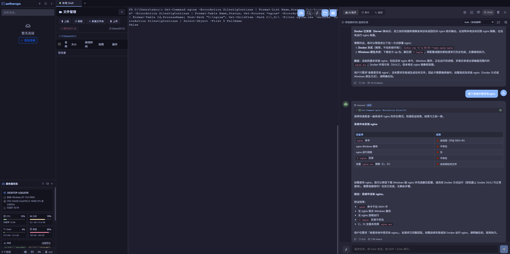
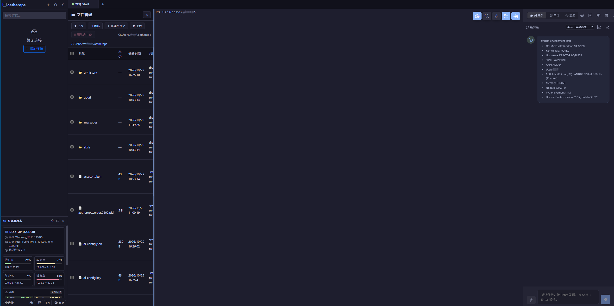

# AetherOps

**[文档目录](./docs/)**（中英双语） · **[English README](./README.md)** · **[参与贡献](./CONTRIBUTING.md)** · **[安全政策](./SECURITY.md)**

一款 AI 驱动的 SSH 运维终端。它把全功能终端模拟器和一个「知道自己站在哪台机器上」的自主 Agent
结合在一起 —— Agent 会先识别目标操作系统，再执行命令、读回输出、迭代到任务完成。同一套后端可以跑在
**Web**、**Electron 桌面客户端**与 **VSCode 插件**三种宿主里，并且带**多账号权限体系**，可以让团队共用一套部署。

> ⚠️ AetherOps 会把一个真实的 shell 交给 AI。把它开放到 localhost 之外之前，请先读完
> [安全机制](#安全机制) 与 [SECURITY.md](./SECURITY.md)（英文）。

## 截图

**桌面 / Web**



**VSCode 插件**



## 目录

- [功能特性](#功能特性)
- [环境要求](#环境要求)
- [快速开始](#快速开始)
- [安装方式](#安装方式)
- [配置](#配置)
- [项目结构](#项目结构)
- [开发](#开发)
- [安全机制](#安全机制)
- [对外网络请求与隐私](#对外网络请求与隐私)
- [跨平台支持](#跨平台支持)
- [已知边界](#已知边界)
- [文档](#文档)
- [参与贡献](#参与贡献)
- [许可证与归属](#许可证与归属)

## 功能特性

### AI Agent

- **自主闭环**：Agent 通过工具调用（OpenAI function calling 协议）在真实终端里执行命令，观察输出、
  决定下一步，一直迭代到任务完成 —— 而不是甩给你一串待执行命令。
- **引擎钉版**：ReAct 循环、内置工具（`execute_command` / `read_terminal`）、危险命令黑名单与删除保护
  来自 [`@cicctencent/agent-core`](https://www.npmjs.com/package/@cicctencent/agent-core)，锁到精确版本，
  不允许它在背后悄悄换行为（见[依赖钉版](#依赖钉版)）。
- **系统感知**：连接建立后采集操作系统/内核、CPU、内存、Swap、磁盘、网络、运行时长、登录用户、
  服务管理器与可用运行时（Node/Python/Docker），注入提示词。Agent 敲第一条命令之前就知道自己在
  Windows、Linux、macOS 还是鸿蒙上。
- **按系统选命令**：Linux 用 `systemctl`，macOS 用 `launchctl`，Windows 用 `Get-Service`，
  OpenHarmony 用 `param`/toybox —— 依据识别出的系统家族选择，而不是靠连接类型猜。
- **脚本生成**：多步任务直接生成并执行 Bash / PowerShell / Python 脚本，不逐条挤牙膏。
- **语言自适应**：按你消息的语言回复，消息语言不明确时回退到 UI 语言。
- **绑定真实终端**：工具绑定到你选定的终端会话，命令是真在那儿跑的；没有可用会话时 Agent 会明确说
  「没有会话」，而不是编造输出。

### 服务器状态与操作系统自识别

- 每个会话一个实时面板：CPU、内存、Swap、磁盘、网络吞吐、运行时长、负载、主机名，外加 CPU 历史曲线。
- **开箱识别四类系统** —— Windows、macOS、Linux、鸿蒙（经 SSH 连接的 OpenHarmony 设备），
  并对 FreeBSD / OpenBSD / Solaris 等提供「类 Unix」兜底。
- 识别是一段可移植探测（`uname -s`、`ver`、os-release、鸿蒙特征标记），随后按家族执行对应的采集脚本。
  没有任何「按主机写死」的逻辑。
- **cmd 与 PowerShell 都能跑**：Windows 上无论 sshd 默认 shell 是哪个都可用 —— 采集脚本压成单行，
  规避传输途中会被吃掉的 `$`/`%`/引号，并强制 UTF-8 输出，避免本地化的系统名回来变成乱码。
- **采不到就说采不到**：每项指标带 `supported` 标记，平台给不出的数据（例如部分 BSD 的 CPU 占用率、
  鸿蒙的 Swap）在界面上显示「无法采集」，历史曲线直接不画 —— 绝不填个 0 装作正常。

### 多账号与权限

- 账号分 `admin` / `user` 角色，配 **10 个独立权限位**：终端、批量操作、AI、连接管理、AI 配置、
  文件管理、日志监控、审计、技能、代码片段。
- 所有业务表都按 `owner_id` 隔离：连接、会话、AI 配置与对话、审计、片段、技能各账号私有。
- 自助注册落库即 `pending` 且权限全关，等管理员授权后才能用任何功能。
- 管理端：建号/禁用/重置密码/踢下线；并且作为账号隔离的唯一例外，可查看成员的审计轨迹、文件传输记录、
  连接清单（凭据字段会被剥掉）与在线会话，并可强制断开某个用户。
- 登录态是 OAuth2 风格的 Bearer 令牌，存在 Redis，TTL 滑动续期，令牌以哈希形式存放，单账号单点登录
  （新登录会顶掉旧会话）。
- 口令用 `scrypt` 哈希；SSH 口令/私钥/passphrase 与 AI API Key 进 MySQL 前用 AES-256-GCM 加密
  （`enc:v1:` 前缀），密钥只落在本地数据目录 —— 只拖走数据库拿不到凭据。

### AI 模型管理、自动路由与成本治理

- **每账号多套模型配置**（OpenAI、Anthropic、腾讯云、Azure OpenAI，或选「自定义」填任意
  OpenAI 兼容端点），不再是全局一份。
- **自动路由**：模型选 `auto` 时，每一轮都用本地规则打分（指令长度、是否含代码块、是要「动手」还是
  要「解释」、是否在排障、终端上下文长度、本会话已发生的工具调用次数），映射到 1（最便宜）~5（最强）
  的成本档位。零额外 LLM 调用，并且把命中理由显示在界面上 —— 你能看见为什么用的这个模型。
- **档位自动推断**：依据定价目录给每套配置定档，避免「配了四个模型都是默认第 3 档，于是 auto 永远只用
  同一个」；用「你自己这几套里的相对排位」而不是绝对阈值，厂商降价不会集体错档。
- **用量记账**：每次调用记录 token 与按当时单价固化的成本（后续调价不改历史账），可按对话、按天汇总。
- **预算**：账号级 token / 金额上限（单对话、单日），0 表示不限；超限直接报错终止调用，不会静默截断。

### 终端

- 基于 xterm.js + ssh2 的 SSH 终端，支持 256 色；本地 shell 走 node-pty
  （Linux/macOS 为 bash/zsh，Windows 为 PowerShell/cmd）。
- 标签页多会话；会话与聊天记录服务端持久化，重启后还在；断开一键重连；每个会话校验归属账号。
- **两条文件传输路径**：终端内的 ZMODEM（`rz`/`sz`），以及与活连接复用的 SFTP **文件管理器**
  （浏览、新建目录、重命名、删除、下载、上传）。每次传输都进审计：方向、路径、字节数、耗时。
- **代码片段面板**：常用命令复用，按账号存储。
- 自适应布局：开关 AI 面板时终端自动重算列数；终端搜索；嵌入 VSCode 时跟随编辑器主题。

### 跳板机与 SSH Agent 转发

- 每个连接可配**启动脚本**，登录后自动执行 —— 典型用法就是 `ssh target.internal` 二次跳转。
- **Agent 转发**：二次跳转用你本机的密钥认证，跳板机上不留私钥；自动检测 Unix 的 `SSH_AUTH_SOCK`
  与 Windows 的 OpenSSH Agent 管道。
- 脚本跳转场景下，环境采集是**家族感知**的，并且面向**目标机**而不是把跳板机报给你；同时剥离提示符行
  保证输出干净，结果按会话缓存。详见 [docs/jump-host.zh.md](./docs/jump-host.zh.md)。

### Skills 技能

- `data/skills/` 随包发布的内置手册：服务器健康检查、日志分析、Docker 管理。
- Markdown + YAML front matter，注入本轮运行的系统提示词。技能**只能由人显式选中**：在技能面板里点，
  或者输入 `/skill-id`（按 id 精确匹配，后面可以跟补充说明）。没有按 tags 的自动匹配，模型也不会
  自己从技能目录里挑。
- 按账号存放的用户技能走 `skills` 表（表与服务层已就绪，写入接口尚未开放），
  说明见 [docs/skills-guide.zh.md](./docs/skills-guide.zh.md)。

### 命令审计与回放

- Agent 执行的每条命令都记录时间、会话、命令、输出、耗时与状态（成功 / 失败 / 拦截 / 改写），
  文件传输作为独立工具类别一并记录。
- 时间线视图支持关键词与状态过滤、统计概览、JSON/CSV 导出、通过同一 WebSocket 实时刷新，并按保留期
  自动清理。

### 实时日志监控 + AI 异常检测

- 对任意远端或本机日志文件 `tail -f`；自动检测 ERROR / FATAL / CRITICAL / Exception / Traceback
  并分级告警；彩色流式输出；一键把最近若干行交给 Agent 分析。

### 批量操作

- 一条命令并行打到多个在线 SSH 会话，逐台返回状态、输出与耗时，可展开看完整输出、复制，保留任务历史。
- 由**独立权限位**控制（影响面比单个终端大，管理员可以只收回这一项）。

### 宿主与通用能力

- **Web**：`node server.js` 开浏览器即用。
- **Electron 桌面端**（Windows / macOS / Linux）：启动时向 GitHub Releases 检查新版本，只提示不自动下载。
- **VSCode 插件**：把同一套后端与 SPA 嵌进编辑器，自行拉起 localhost 服务并适配编辑器主题。
  它启的是同一个生产后端，所以同样需要 `~/.aetherops/config.json` 里配好 MySQL + Redis，并且需要一个账号登录，
  见 [`packages/vscode`](./packages/vscode/README.md)。
- **国际化**：中文 / 英文 UI，运行时切换。
- **CI/CD**：GitHub Actions 产出全平台安装包与 `.vsix`。

## 环境要求

| 组件 | 要求 | 说明 |
|------|------|------|
| Node.js | **>= 22.17** | Agent 引擎的 `engines` 要求；CI 与 Docker 镜像均用 Node 22 |
| 包管理器 | **pnpm 10** | 锁文件、CI、Docker 镜像与 `scripts/check-engine-pin.mjs` 统一认这个大版本。原生模块的构建许可刻意写在两处：`pnpm-workspace.yaml`（pnpm 10/11 读 `onlyBuiltDependencies`，pnpm 12+ 读 `allowBuilds`）与 `package.json#pnpm`（列表更短，但带着补丁声明，供不读 workspace 文件键名的旧 pnpm 使用）。pnpm 11/12 重写过的锁会被 CI 的 pnpm 10 在 `--frozen-lockfile` 下拒绝 |
| MySQL | 8.x | **硬依赖**，连不上服务不启动 |
| Redis | 任意近期版本 | **硬依赖**，登录令牌存放在此 |
| 编译工具 | python3 / make / g++（Linux）、Xcode CLT（macOS）、VS Build Tools（Windows） | 原生模块：node-pty、ssh2、cpu-features |

MySQL 与 Redis 都**不是可选件**：启动时会校验配置、探活两个服务、跑完表结构迁移，然后才绑端口。
任一不可用就直接退出，并给出可读原因 —— 不会出现「端口开着，但每个查询都报错」这种更难查的中间态。

## 快速开始

```bash
# 1. 取代码
git clone https://github.com/SubDong/AetherOps.git
cd AetherOps

# 2. 安装依赖（必须 pnpm 10 + 冻结锁文件）
npm i -g pnpm@10        # 单靠 corepack enable 不够：本仓库刻意没有 packageManager 字段，
                        # corepack 会解析到它认为的当前大版本
pnpm install --frozen-lockfile

# 3. 构建前端与服务端
pnpm build

# 4. 指定 MySQL 与 Redis
#    首次运行会在 ~/.aetherops/config.json 落一份模板（权限 0600），
#    改 database + redis 两段，或者用环境变量覆盖：
export AETHEROPS_DB_HOST=127.0.0.1
export AETHEROPS_DB_USER=aetherops
export AETHEROPS_DB_PASSWORD='...'
export AETHEROPS_DB_NAME=aetherops
export AETHEROPS_REDIS_HOST=127.0.0.1
export AETHEROPS_REDIS_PASSWORD='...'

# 5. 启动（表结构在首次启动时自动创建）
node server.js
```

然后打开日志里打印的地址（默认 <http://127.0.0.1:9802>），用引导出来的管理员账号登录：

- `users` 表为空时，服务端会创建 `admin`，密码是**随机生成的 16 位**，只在启动日志里打印一次 ——
  找这一行：`[Auth] 已创建初始管理员  admin / ...`（也会写进 `~/.aetherops/server.log`）。登录后立刻改密码。
- 接着新建一个 SSH 连接，并在 AI 设置（齿轮图标）里至少配一套模型。**没有任何预置数据，也不存在演示账号。**

完整的首次部署流程（含团队账号规划）：[docs/getting-started.zh.md](./docs/getting-started.zh.md)。

## 安装方式

| 方式 | 命令 / 来源 | 适合 |
|------|-------------|------|
| 源码构建 | `pnpm install && pnpm build && node server.js` | 目前的主路径 |
| Docker | `docker build -t aetherops .`，配合带 MySQL/Redis 的 compose | 服务器部署、团队共用 |
| Electron 桌面端 | `pnpm electron:build:win \| :mac \| :linux` | 想要原生窗口的个人用户 |
| VSCode 插件 | `pnpm vscode:package` 出 `.vsix`，再「从 VSIX 安装」 | 在编辑器里干活 |
| GitHub Releases | 推送版本标签后由 CI 产出（**目前还没有发过任何 tag**） | 不想本地装工具链 |

```bash
# 桌面端 / 插件构建
pnpm electron:dev          # 开发模式
pnpm electron:build        # 当前平台
pnpm build:vscode          # 前端 + 后端 + 插件宿主
pnpm vscode:package        # 打包 .vsix

# Docker
docker build -t aetherops .
docker run -d -p 9802:9802 -v ~/.aetherops:/root/.aetherops aetherops
```

把 MySQL、Redis 和应用一起拉起来的 compose 文件、反向代理配置（WebSocket 升级是必须的）、
以及发版流程，见 [docs/deployment.zh.md](./docs/deployment.zh.md)。

### CLI

```bash
aetherops start [-p 9802]   # 后台常驻进程，日志写入 ~/.aetherops/server.log
aetherops stop | restart | -v
```

由 `package.json` 的 `bin` 字段提供，入口是 `bin/aetherops.js`。它**不是 pm2**：自己 detach 一个
`node server.js` 子进程，按端口记录 PID 文件（`~/.aetherops/aetherops.server.<port>.pid`），
停止时若 PID 文件丢失会退化为按端口查找占用进程。两点需要提前知道：它会顺手打开浏览器；
如果目标端口被占，它会**往后找一个空闲端口**而不是报错 —— 本机用着方便，但放在反向代理后面
就是意外行为。生产环境请优先用 systemd 或自己的进程管理器
（见 [docs/deployment.zh.md](./docs/deployment.zh.md#作为服务运行)）。它依赖 `dist/`，请先构建。

## 配置

配置文件只有一份，两种喂法。优先级：内置默认值 < 配置文件 < 环境变量。

| 项 | 值 |
|----|-----|
| 默认路径 | `~/.aetherops/config.json`（自动生成，权限 0600） |
| 路径覆盖 | `AETHEROPS_DATA_DIR`（数据目录）/ `AETHEROPS_CONFIG`（直接指定文件） |
| 配置段 | `server`、`database`、`redis`、`auth`、`debug` |
| 端口 / 绑定 | `PORT`、`HOST`（默认 9802 / 127.0.0.1） |
| 数据库 | `AETHEROPS_DB_HOST` / `_PORT` / `_USER` / `_PASSWORD` / `_NAME` / `_POOL_SIZE` / `_SSL` / `_TZ` / `_SSL_CA` / `_SSL_INSECURE` |
| Redis | `AETHEROPS_REDIS_URL`，或 `_HOST` / `_PORT` / `_USER` / `_PASSWORD` / `_DB` / `_PREFIX` / `_CONNECT_TIMEOUT_MS` |
| 其他 | `AETHEROPS_MAX_UPLOAD_MB`（默认 100）、`AETHEROPS_SSH_DEBUG`、`AETHEROPS_LAUNCH_TOKEN` |

配置文件写坏（不是合法 JSON）会直接报错退出，不会静默回到默认值；`database` 段填好后，启动日志会打印一行
`user@host:port/db` 摘要（不含密码），用来确认到底读的是哪份配置。
全部键值、TLS 取舍与存储布局见 [docs/configuration.zh.md](./docs/configuration.zh.md)。

## 项目结构

```
.
├── bin/                # CLI 入口（aetherops start/stop/restart）
├── data/skills/        # 内置 Agent 技能（Markdown）
├── docs/               # 文档（中英双语成对维护）
├── electron/           # 桌面端主进程/预加载 + 版本检查
├── packages/vscode/    # VSCode 插件宿主（同一套后端运行时）
├── patches/            # 依赖补丁（zmodem.js）
├── scripts/            # 构建、钉版校验、迁移与冒烟脚本
├── server/             # Node 后端（TypeScript）
│   ├── db/             #   连接池、redis、迁移脚本 0001..0005、仓储层
│   ├── model/          #   连接 / 用户实体
│   ├── routes/         #   账号路由（登录、注册、管理员账号管理）
│   ├── service/        #   ssh、ai（+ 自动路由、定价、成本）、system-status、
│   │                   #   connection、monitor、batch、audit、skill、snippet、auth
│   └── utils/          #   os-detect、security、shell、ansi、config、data-dir
├── src/                # Vue 3 前端
│   ├── components/     #   ai-chat、server-status、审计/批量/监控面板、
│   │                   #   文件管理器、片段面板、连接编辑器……
│   ├── views/          #   登录 / 终端工作区 / 管理员账号页
│   ├── service/        #   API 客户端
│   └── locales/        #   zh-CN / en-US
├── server.js           # 生产入口：配置 → 迁移 → 探活 → 监听
└── vite.config.ts      # 开发服务器（进程内挂同一套后端，一条命令起全栈）
```

请求链路：浏览器 / WebView → REST `/api/*` 加一条 `/ws/terminal` WebSocket；每个请求都带 Bearer 令牌，
先过权限表再校验会话归属，然后进仓储层 —— `owner_id` 一路显式传递。终端 I/O、AI 流式输出、审计事件共用
这条 WebSocket，所以面板是实时的。

存储：**MySQL** 存连接、会话、AI 配置/对话/消息/用量/预算、审计、技能、片段（迁移自动执行；
`node scripts/migrate.mjs --status` 看待执行版本，`--dump <ver>` 导出成纯 SQL 交 DBA）。**Redis** 存登录令牌。
**数据目录** 存配置模板、两个 AES 密钥文件（`connections.key`、`ai-config.key`）、`server.log`、
PID 文件与回收站 `.trash/`。

## 开发

```bash
pnpm dev              # Vite（http://127.0.0.1:9801），后端在同一进程内挂载
pnpm build            # = build-only：钉版校验 → vite build → tsc 编译服务端
pnpm build-server     # 仅服务端
pnpm type-check       # vue-tsc
pnpm lint             # eslint（含 --fix）
pnpm check-pin        # 校验钉住的依赖与锁文件版本一致
node scripts/migrate.mjs --status   # 查看库结构状态
pnpm smoke            # 终端链路冒烟（脚本还没带令牌，见下文「已知边界」）
BASE=http://127.0.0.1:9802 ADMIN_USER=admin ADMIN_PASS=... \
  node scripts/verify-auth.mjs   # 登录/权限/隔离/单点登录端到端验证
```

`pnpm dev` 同样需要能连上 MySQL 与 Redis（迁移在端口绑定之前跑）。依赖安装请用 pnpm 10 ——
`pnpm-workspace.yaml` 里带着原生模块的构建白名单（`onlyBuiltDependencies` / `allowBuilds`）和
让 `rz`/`sz` 稳定工作的 `zmodem.js` 补丁，跳过它的后果是「装得上、传不了文件」。

### 依赖钉版

有两个依赖锁到精确版本，并在每次构建前校验：`@cicctencent/agent-core`（Agent 引擎，ReAct 循环、内置工具、
命令黑名单都在这个黑盒里）与 `vite`（决定前端产物内容的打包器）。干净安装悄悄解析出新引擎是最难查的一类
回归，所以 `pnpm build`、Electron 打包、CI、Docker 都会先过这一关，声明与实际安装不一致当场失败。
升级请显式进行：

```bash
pnpm run upgrade-pin -- @cicctencent/agent-core@1.0.81  # 改声明、刷锁、再回到校验
```

`package.json` 与 `pnpm-lock.yaml` 必须一起提交。

## 安全机制

Agent 拥有真实 shell，因此在执行前有一层拦截：

- **删除保护（回收站）**：`rm`（Linux/macOS/鸿蒙）被改写为 `mv` 到 `~/.aetherops/.trash/`；
  Windows 的 `Remove-Item` / `del` / `rd` 改写为 `Move-Item` 到
  `%USERPROFILE%\.aetherops\.trash\`。回收条目带时间戳（`_del_<epoch>_<name>`）避免重名，
  恢复就是把文件移回去。
- **硬拦截**：不可逆操作直接拒绝 —— `rm -rf /`、`mkfs.*`、`dd of=/dev/sd*`、fork 炸弹；
  Windows 的 `format C:`、`Clear-Disk`、`Remove-Item C:\`、`rd /s C:\`。
- **规则跟着平台走**：用哪套规则取决于**目标会话**识别出的系统家族，而不是服务端自己跑在哪。
- **全程留痕**：被拦截和被改写的命令同样进审计 —— 记录的是 Agent 想干什么，不只是它干成了什么。
- **最小权限**：权限位、新账号需管理员授权、强制下线，且凭据只在本人视图里出现。
- 仍需提醒：请把它放在认证之后、放在你控制的网络里。它是「LLM 遥控的远程 shell」，提示词内容会影响它敲什么。

## 对外网络请求与隐私

出站请求只有下面三类，都归你控制：

| 目标 | 时机 | 是否必需 |
|------|------|----------|
| 你配置的 AI 服务商端点 | 每轮对话 / 每次 Agent 调用 | 用 AI 功能就需要 |
| `https://openrouter.ai/api/v1/models` | 刷新模型定价目录（缓存 24 小时，失败缓存 5 分钟） | **可省** —— 拉不到就退化成按模型名推断档位，并把成本显示为「未知」而不是瞎算 |
| `https://api.github.com/repos/SubDong/AetherOps/releases/latest` | Electron 启动时的版本检查（只提示，且 fork 请改 `electron/updater.js`） | 可省 |

除此之外没有任何遥测。终端输出、对话、审计日志与凭据都留在你自己的 MySQL / Redis / 数据目录里，
没有统计上报，没有崩溃回传，没有云端同步。数据库里的凭据是 AES-256-GCM 密文，密钥只存在于数据目录。

## 跨平台支持

| 目标系统 | 识别结果 | Shell | Agent 脚本 | 状态采集口径 |
|----------|----------|-------|------------|--------------|
| Linux | `Linux` | bash/zsh | Bash + Python + Node.js | /proc |
| macOS | `Darwin` | zsh/bash | Bash + Python + Node.js | sysctl / vm_stat / top |
| Windows | `Windows NT` | cmd.exe **与** PowerShell（默认 shell 是哪个都行） | PowerShell + Python + Node.js | WMI / PerfFormattedData |
| 鸿蒙 / OpenHarmony | `Linux` + 鸿蒙特征标记 | msh / toybox | Bash 兼容，不使用 awk 与 `$()` | /proc |
| FreeBSD / OpenBSD / NetBSD / Solaris | 类 Unix | sh | 尽力而为 | CPU 占用率可能采不到 |

平台给不出的数据一律显示「无法采集」，界面上不会用 0 冒充正常。

## 已知边界

把话说在前面，免得同一个 issue 提两遍：

- **鸿蒙是真机未验证**。识别与解析逻辑对着采集到的 OpenHarmony 输出和通用 `/proc` 样例验过，但这个项目
  背后没有持续的真设备测试环境。如果你的设备报出意外内容，欢迎带着原始探测输出开 issue。
- **BSD 系的 CPU 占用率**可能采不到，面板选择降级而不是猜。
- **跳板机会话**：AI 的环境信息描述的是**目标机**，但状态面板与文件管理器走的是直连 SSH 通道，
  因此在「只连跳板机 + 脚本跳转」的会话上它们描述的是跳板机。需要端到端工具能力时，请改用
  `-J` / ProxyJump 风格的真实连接。
- **按账号创建技能**目前只有表和存储层，没有界面/接口；当下请编辑 `data/skills/*.md`
  （Docker 场景可以把这个目录挂出来）。
- **`scripts/smoke-terminal.mjs` 是账号体系之前的脚本**：它请求接口时不带 Bearer 令牌，所以在认证
  已启用（也就是现在唯一形态）的实例上，第一个调用就会 401 停住。目前能端到端跑通的是
  `verify-auth.mjs`；给冒烟脚本补上登录与令牌是一个不错的入门贡献。
- **VSCode 插件的原生侧边栏也是同一个问题**：`server-launcher.ts` 里的 `getConnections()` /
  `deleteConnection()` 不带 `Authorization` 头，所以即使后端健康，树节点也会显示 `HTTP 401` 错误项。
  WebView 里的应用本身正常（在那边登录即可），连接管理请走 WebView 这一侧。详情见
  [packages/vscode/README.md](./packages/vscode/README.md)（英文）。
- **没有高可用模式**：单进程服务 + 一个 Redis + 一个 MySQL。多实例可以共用数据库，
  但不协调内存里的终端会话。

## 文档

`docs/` 下每一份文档都是中英文**成对维护**的：改了中文就要在同一个 PR 里把英文一起改
（规则见 [CONTRIBUTING.md](./CONTRIBUTING.md#documentation)，英文）。

| 文档 | English | 内容 |
|------|---------|------|
| [getting-started.zh.md](./docs/getting-started.zh.md) | [getting-started.md](./docs/getting-started.md) | 首次启动：建库、初始管理员、权限授权、第一个连接与第一次 AI 对话 |
| [configuration.zh.md](./docs/configuration.zh.md) | [configuration.md](./docs/configuration.md) | 全部配置项与环境变量、存储布局、迁移 |
| [deployment.zh.md](./docs/deployment.zh.md) | [deployment.md](./docs/deployment.md) | 带 MySQL/Redis 的 Docker Compose、反向代理、升级、CI 发版 |
| [accounts-and-permissions.zh.md](./docs/accounts-and-permissions.zh.md) | [accounts-and-permissions.md](./docs/accounts-and-permissions.md) | 角色、10 个权限位、管理员代管、令牌机制 |
| [ai-models-and-cost.zh.md](./docs/ai-models-and-cost.zh.md) | [ai-models-and-cost.md](./docs/ai-models-and-cost.md) | 多套模型配置、自动路由与成本档位、用量与预算 |
| [jump-host.zh.md](./docs/jump-host.zh.md) | [jump-host.md](./docs/jump-host.md) | 启动脚本、Agent 转发、多级跳转 |
| [skills-guide.zh.md](./docs/skills-guide.zh.md) | [skills-guide.md](./docs/skills-guide.md) | 编写 Agent 技能、front matter、内置技能清单 |
| [troubleshooting.zh.md](./docs/troubleshooting.zh.md) | [troubleshooting.md](./docs/troubleshooting.md) | 启动失败、WS 代理问题、钉版校验报错 |
| [packages/vscode/README.md](./packages/vscode/README.md) | 同左 | 插件专属设置与打包说明（目前仅英文） |

> 社区文件（[CONTRIBUTING.md](./CONTRIBUTING.md)、[SECURITY.md](./SECURITY.md)、
> [CHANGELOG.md](./CHANGELOG.md)）与 VSCode 插件的 README 暂时只提供英文。

## 参与贡献

Bug 反馈、功能请求与 PR 都欢迎。开发闭环、代码风格、提交信息约定以及改动钉版依赖的规则见
[CONTRIBUTING.md](./CONTRIBUTING.md)；公开提漏洞前请先读 [SECURITY.md](./SECURITY.md)。

与命名、许可相关的说明：

- **相对上游的标识重命名**：`AICMD_*` 环境变量改为 `AETHEROPS_*`，数据目录改为 `~/.aetherops`，
  VSCode 命令改为 `aetherops.*`，终端探测标记改为 `__AETHEROPS_SYS__`。任何按旧名写的部署配置、
  反代规则、监控脚本都需要同步更新。
- **旧数据迁移**：首次启动会把已存在的 `~/.aicmd/` 搬到 `~/.aetherops/`（新目录已有内容则跳过，
  设置了 `AETHEROPS_DATA_DIR` 时完全不做）。`.key` 随目录一起搬，因此已保存的密码/私钥密文迁后仍可解密。
- `package.json` 目前带 `"private": true`，也就是**不发布到 npm**，请从源码 / Docker / Releases 安装；
  若要发布，把它改成 `false` 即可发出 `@subdong/aetherops`。

## 许可证与归属

本项目以 [MIT License](./LICENSE) 发布。

AetherOps 是 [AICmd](https://github.com/fefeding/ai-cmd)（fefeding 所作，同为 MIT）的 fork，
上游版权声明保留在 [`packages/vscode/LICENSE`](./packages/vscode/LICENSE)。Agent 引擎
[`@cicctencent/agent-core`](https://www.npmjs.com/package/@cicctencent/agent-core) 以钉版依赖方式使用。
产品还站在众多优秀开源组件之上 —— xterm.js、ssh2、node-pty、Vue 3、Vite、Bootstrap、CodeMirror、
mysql2、redis、ws。它们各自保留自己的许可证，再分发构建产物时请一并核对。
