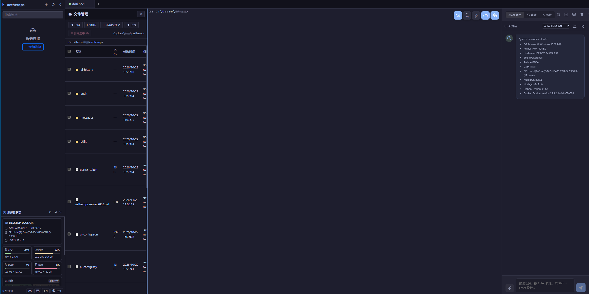

# AetherOps Terminal — VSCode Extension

Bring [AetherOps](https://github.com/SubDong/AetherOps) (an AI-powered web SSH terminal) directly into VSCode. The extension launches AetherOps's backend service (Express + WebSocket) inside the VSCode extension host and loads its front-end SPA through a WebView, so **every AetherOps feature works inside VSCode with zero changes to any business code**:

## Screenshot



- SSH / local terminal (xterm.js + ssh2 / node-pty)
- Autonomous AI Agent (OpenAI function-calling protocol)
- Skills system (built-in skills + custom `/skill`)
- Command audit & replay (timeline / stats / export)
- Real-time log monitoring + AI anomaly detection
- Batch operations (parallel multi-server execution)
- Jump host & SSH agent forwarding
- File transfer (rz/sz ZMODEM, SFTP upload/download)

> The extension reuses the **same project** (this repository) at runtime: it starts the project's own `server.js` as a child process and serves the project's own `dist/` front-end. No separate AetherOps install is required.

## How It Works

```
VSCode Extension Host
  └─ child process: node server.js --port <random free port>   (reuses project root backend, bound to 127.0.0.1)
        ├─ REST API   /api/**
        └─ WebSocket  /ws/terminal
  └─ WebView (iframe → http://127.0.0.1:<port>/)   (same-origin front-end SPA)
```

- The backend runs as a **child process** that reuses the project root's `server.js`, so all features are reused unchanged.
- The WebView loads the front-end through a **same-origin iframe**, which means there is no CORS or
  cross-origin cookie problem to solve. It does **not** mean authentication is skipped: the backend
  requires a logged-in account, so the first thing the WebView shows is the login page (see
  [Requirements](#requirements)).
- The data directory defaults to `~/.aetherops` (overridable via the `aetherops.dataDir` setting) and
  is **shared with the standalone desktop / CLI AetherOps**: same `config.json`, same AES key files,
  same log. The connection list itself is no longer a `connections.json` file — it lives in **MySQL**,
  scoped to the signed-in account, so the VS Code host sees exactly the connections that account owns.

## Requirements

- VSCode `^1.75.0` or later.
- A built AetherOps project (front-end + backend) — see [Local Development](#local-development).
- Node.js **>= 22.17** available to launch the backend. The extension locates a `node` binary
  automatically (see [Environment Variables](#environment-variables)); you normally do not need to set
  anything.
- **MySQL and Redis reachable, and configured.** The extension starts the ordinary production backend,
  which refuses to bind a port without them. It adds `AETHEROPS_DATA_DIR`, `AETHEROPS_LAUNCH_TOKEN` and
  `NODE_ENV` to a copy of VS Code's own environment (dropping `NODE_OPTIONS`, which would crash a clean
  Node start), so `AETHEROPS_DB_*` variables work only if the VS Code process itself has them — launching
  from a desktop icon usually means it does not. Put the settings in `~/.aetherops/config.json`: complete
  step 3 and 4 of [docs/getting-started.md](../../docs/getting-started.md) once, and every host — CLI,
  desktop, this extension — then shares that one configuration.
- An **account** to sign in with. On a fresh database the first `node server.js` boot prints a random
  password for `admin`; that is the account to use in the WebView.

## Installing the Extension

### From a packaged `.vsix`

```bash
# Build the package first (see Packaging below), then install:
code --install-extension aetherops-terminal-*.vsix
```

### From source (development)

See [Local Development](#local-development). After compiling, press **F5** in VSCode to launch the *Extension Development Host*.

## Usage

### Open the Activity Bar

After activating the extension, an **AetherOps** icon appears in the left Activity Bar. Click it to reveal the **Terminal** explorer view, which lists:

- **Open Local Shell** — opens a native local shell (`__local__` connection) inside a VSCode WebView tab.
- **Saved connections** — the connection list owned by the signed-in account, read from the backend
  (it is stored in MySQL, not in a file). SSH connections show a globe icon; local connections show a
  terminal icon, with the host and username as a description.
- **No connections yet** hint — appears when the connection list is empty; click the **+** button in the view title to add one.

### Open a terminal

You can open a terminal in three ways:

1. **Command Palette**: press `Ctrl/Cmd + Shift + P`, then run **`AetherOps: 打开终端`** (command id `aetherops.openTerminal`).
2. **Activity Bar → Terminal view**: click the **Open Local Shell** entry, or click any connection node to open that connection.
3. **Connection node inline action**: hover a connection in the Terminal view and click the terminal icon that appears on the right.

The first launch automatically finds an available port and starts the backend service, then opens the terminal UI in a WebView. Re-opening the same connection appends a number to the tab title (`server 2` / `server 3` …) so multiple sessions stay distinguishable.

### Manage connections

All connection management reuses the same backend and storage as the desktop / CLI app:

- **Add connection**: click the **+** button in the Terminal view title bar (or run `aetherops.addConnection`). A dedicated connection-editor WebView opens; fill in host/port/auth and save.
- **Edit connection**: right-click a connection → **Edit**, or run `aetherops.editConnection`. The same editor WebView opens pre-filled. After saving, the tree refreshes automatically and the editor closes.
- **Delete connection**: right-click a connection → **Delete**, or run `aetherops.deleteConnection`. A confirmation dialog appears; confirming removes the connection via the backend API and refreshes the tree.
- **Refresh**: click the **⟳** button in the view title bar (or run `aetherops.refresh`) to re-read the connection list from the backend.

> The connection editor is the same `ConnectionEditor` component used by the desktop app, so startup scripts and SSH agent forwarding for jump-host workflows are fully supported here too.

### Configure AI

1. In the terminal WebView, click the robot icon (bottom-left sidebar) or the gear icon in the AI chat header.
2. Enter your API Key and Base URL (OpenAI, DeepSeek, Qwen, or any compatible endpoint).
3. Choose a model (default: `gpt-4o-mini`) and save.
4. You can now chat with the AI Agent in natural language — it observes terminal output, runs commands, and iterates until the task is done.

### File download (sz / ZMODEM)

When a terminal session triggers a file download (e.g. `sz file`), the WebView posts a save request to the extension host. VSCode shows a native **Save As** dialog; choose a destination and the file is written to disk.

### Stopping the backend

The backend child process starts on demand and **stops automatically** when all AetherOps WebView panels are closed (and no editor panel is open). It also stops when the extension is deactivated. If the backend crashes unexpectedly, all panels close and an error notification is shown; re-open a terminal to restart it.

## Settings

Open **Settings → Extensions → AetherOps** (or add to `settings.json`):

| Setting | Type | Default | Description |
|---------|------|---------|-------------|
| `aetherops.dataDir` | string | *(empty)* | Data directory holding `config.json`, the AES key files, `server.log` and `.trash/`. Empty means `~/.aetherops`, shared with the desktop / CLI app. Business data (connections, chats, audit) is in MySQL, not here. |
| `aetherops.startPort` | number | `9802` | Starting port used when launching the AetherOps service inside VSCode. If occupied, the extension scans forward for a free port. |

> Changing `aetherops.dataDir` or `aetherops.startPort` requires reloading the VSCode window to take effect (a notification prompts you to reload).
>
> Note the port scan: because the extension may land on 9803 instead of 9802, a VS Code session and a
> manually started `node server.js` do not automatically share the same backend — they share the data
> directory and the database, but each holds its own live terminal sessions.

## Environment Variables

- `AETHEROPS_NODE`: Path to the `node` executable used to launch the backend. By default the extension prefers the VSCode host runtime (Electron), then falls back to nvm / Homebrew / system node. Set this only if auto-detection fails.
- `AETHEROPS_DATA_DIR`: Overrides the data directory for connections / sessions / AI config / audit logs (default `~/.aetherops`). Takes precedence over `aetherops.dataDir` setting.

> The local-shell entry uses the special connection id `__local__`, which makes the backend spawn a local terminal session directly.

## Local Development

```bash
# 1. Install dependencies (ensure node-pty is compiled for your local Node)
pnpm install

# 2. Build the front-end + backend (produces dist/)
pnpm build-only

# 3. Install the extension's own build deps and compile the extension host
cd packages/vscode
npm install        # installs esbuild / @types/vscode / vsce
npm run compile    # or `npm run watch` for continuous rebuild
cd ../..

# 4. Press F5 in VSCode to launch the "Extension Development Host"
```

The F5 launch uses a `preLaunchTask` that automatically runs `pnpm build:vscode` (front-end + backend + extension host together).

## Packaging & Publishing

```bash
pnpm build:vscode      # build front-end + backend + extension host
cd packages/vscode
vsce package           # produce a .vsix
vsce publish
```

> The distributed package must include the runtime (`server.js`, `dist/`, `data/skills`, and `node_modules` with the native `node-pty`). The current layout targets **in-repo development / source distribution**. For cross-machine installation, copy the runtime into `packages/vscode/runtime/` (`server.js`, `dist`, `data`) before running `vsce package` — the extension automatically prefers that directory when present.

## Notes

- The extension's backend listens only on `127.0.0.1`, and the WebView loads the front-end from the same
  origin, so there is no CORS or cookie plumbing to configure. Authentication is still required: the
  first API call from a fresh WebView returns 401 and the iframe replaces itself with the normal
  `/login` page. Sign in with an account (the same one the web/desktop app uses) and the terminal page
  reloads authenticated. Login state lives in `localStorage` under `aetherops.auth.v1` for that
  `127.0.0.1:<port>` origin.
- Backend logs are written to the **Output** panel → channel **AetherOps** (and `[aetherops-server]` for
  the child process) for troubleshooting startup issues.
- The WebView follows your VSCode color theme (light / dark / high-contrast) automatically.

## Known gaps in this host

Stated plainly, because these are the first things a new user hits:

- **The native sidebar list can be empty with an error node.** `ServerLauncher.getConnections()` and
  `deleteConnection()` call the backend over plain HTTP **without an `Authorization` header** — they
  predate the account system. Against a current build those calls get 401 and the tree renders
  "服务未启动，点击刷新" with an `HTTP 401` description, even though the backend is healthy. The WebView
  application is unaffected once you are signed in there: use its connection management (the
  `connections` permission bit) as the working path, and treat the sidebar as a convenience that needs
  the same token plumbing. Making the extension host authenticate (or delegate the list to the WebView)
  is tracked in [CONTRIBUTING.md](../../CONTRIBUTING.md) as a known gap.
- **A missing database configuration looks like a broken extension.** The backend child does inherit VS
  Code's environment, but VS Code launched from a GUI rarely has `AETHEROPS_DB_*` in it, so the
  practical source of database settings is `~/.aetherops/config.json`. Without them the child exits on
  `[FATAL] 数据库配置不完整` and the extension can only report "server did not become ready" — read the
  `[aetherops-server]` lines in the Output panel for the actual reason.
- **The extension can reuse a server that is already running.** Before spawning a child it probes
  `/health` on ports from `aetherops.startPort` upward. That probe sends no launch token, so it succeeds
  only against an instance started without `auth.launchToken` configured — a server launched by another
  extension instance (which injects its own token) is not reusable and a second backend gets started.
- **Packaging for other machines** still requires the runtime copy step described in
  [Packaging & Publishing](#packaging--publishing); a VSIX built without
  `node scripts/prepare-vscode-runtime.mjs` ships without a backend.
